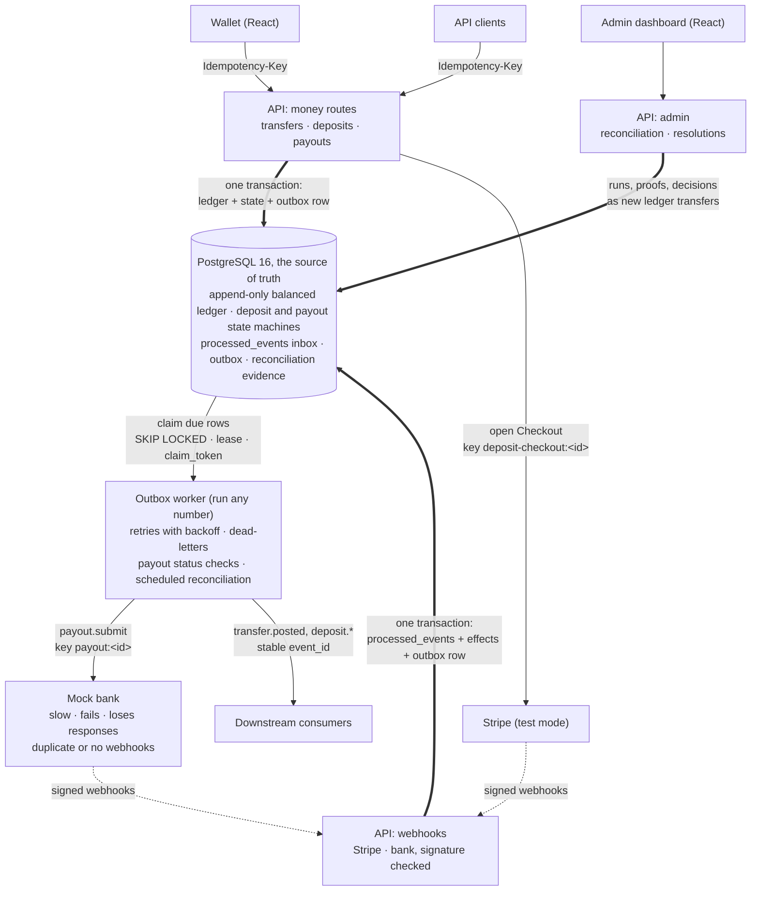
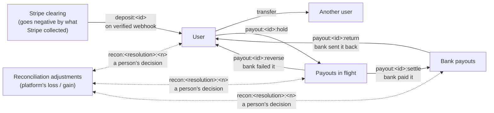
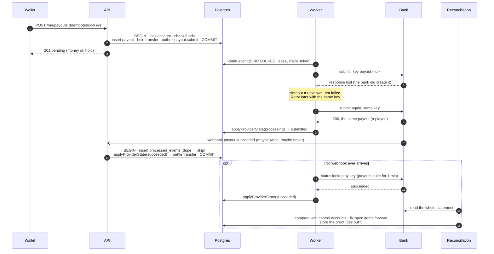
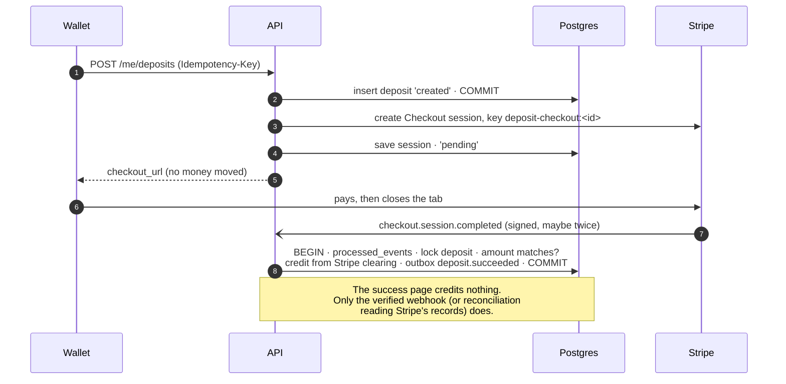
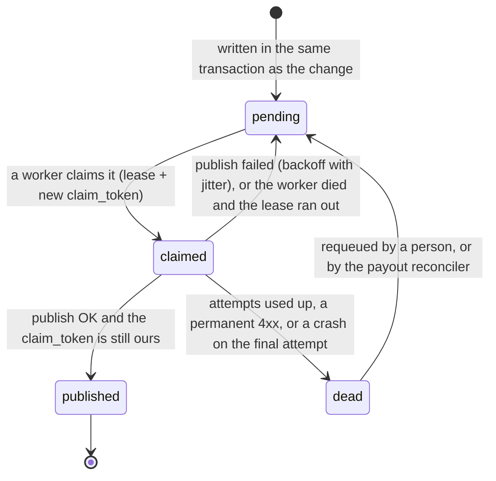

# Architecture

Four processes and one database. Everything that must be correct lives in
PostgreSQL; the processes are stateless and can be restarted or multiplied at
any time. The diagrams render on GitHub (Mermaid).

## The pieces

Reconciliation (from the admin API or on the worker's schedule) also reads each
provider's whole statement: the bank's payouts and Stripe's Checkout Sessions.

What each process is allowed to do:

| Process | Writes money? | Talks to the outside? |
|---|---|---|
| API request handlers | Yes, one transaction per request: ledger rows, state change and outbox row together | Only to open a Stripe Checkout session, *before* any money moves |
| Webhook handlers | Yes, in the same transaction as the `processed_events` row | No |
| Outbox worker | Only through the same functions a webhook uses (`applyProviderState`) | Yes, but never inside a database transaction |
| Reconciliation run | Only forward fixes through the webhook's own functions; anything else waits for a person | Reads statements |

## The rules the database enforces

These are not conventions in application code; a bug cannot break them.

| Rule | How |
|---|---|
| Every transfer balances | Deferred constraint trigger: entries per transfer sum to zero at `COMMIT` |
| History is never rewritten | Triggers reject `UPDATE`, `DELETE`, `TRUNCATE` on `ledger_entries` and on the reconciliation evidence tables |
| A balance is the sum of its entries | `balance_cents` is written only by the ledger insert trigger |
| Users cannot overdraw | `CHECK (kind = 'system' OR balance_cents >= 0)` |
| One operation per idempotency key | `UNIQUE (idempotency_scope, idempotency_key)` on `transfers` |
| One effect per webhook | `PRIMARY KEY (provider, event_id)` on `processed_events` |
| Held money goes one way | `CHECK (settle_transfer_id IS NULL OR reverse_transfer_id IS NULL)` on `payouts` |
| A deposit is credited iff it succeeded | `CHECK ((status = 'succeeded') = (transfer_id IS NOT NULL))`, `transfer_id` unique |

## Where money sits

System accounts make every in-between state visible as a balance. Reconciliation
compares these control accounts, item by item, with each provider's records.

## A payout, end to end

The request never waits for the bank. The hold and the instruction to pay
commit together, and the bank's answer can arrive three ways, in any order,
any number of times.

`applyProviderState` moves our payout *towards* the bank's state, so stale or
repeated news is a no-op, and a contradiction of a final state is recorded as a
discrepancy for a person, never fixed by code. The full matrix is in the
[README](../README.md#how-does-our-system-recover-when-the-providers-state-differs-from-ours).

## A deposit

## The outbox worker

(`claimed` is not a stored status: it is `pending` with `next_attempt_at` pushed
out by the lease, which is why a dead worker can never leave a row stuck.)

A worker that crashes simply lets its lease expire; another picks the row up.
A worker that stalls and wakes late cannot complete the row, because a new claim
issued a new `claim_token` (fencing). Delivery is at least once, so every event
carries a stable `event_id` for consumers to dedupe on.
