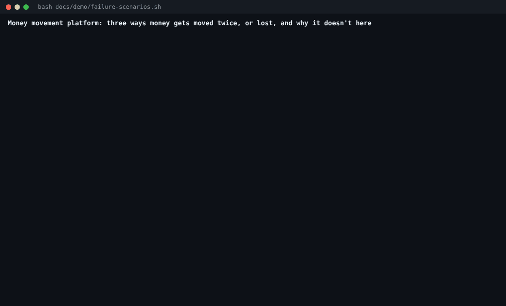
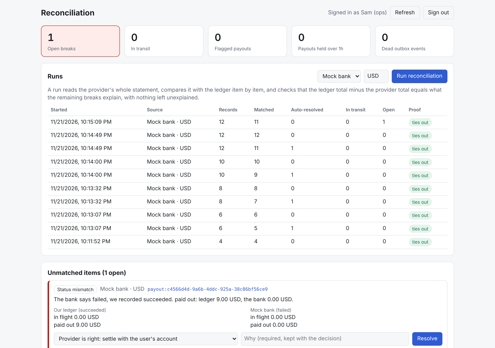

# Failure-scenario demo



[`failure-scenarios.sh`](failure-scenarios.sh) plays three failure scenarios
against a running stack and checks each outcome, printing ✓ or ✗:

| Scenario | What it does | What it checks |
|---|---|---|
| **Duplicate transfer** | Sends the same `POST /me/transfers` twice in parallel, with one `Idempotency-Key` | Both responses name one transfer, one was replayed, one posting, the balance moved once |
| **Duplicate webhook** | Pays a deposit with the demo checkout's *deliver the webhook twice*; then makes the mock bank send every webhook three times and withdraws | One credit for the deposit; three deliveries of the same bank event, one `settle` transfer |
| **Lost provider response** | Makes the bank lose its next response and stop sending webhooks, then withdraws | The bank paid it and we still say pending; one reconciliation run settles it with one transfer, the bank holds one payout, the proof ties out, and a second run finds nothing to fix |

```bash
docker compose up --build                # starts everything and seeds Alice, Bob and Carol
bash docs/demo/failure-scenarios.sh      # about 10 seconds; PAUSE=2 adds pauses for presenting
```

It needs `curl` and `jq`, and `DEMO_MODE=true` (the compose default), because
it uses the wallet API, the admin API (`ADMIN_TOKEN`, default
`local-admin-token`) and the mock bank's switches on port 4000. `API_URL` and
`BANK_URL` override the addresses. Every run uses fresh idempotency keys, and
the bank's switches are put back when it exits, so it can be run any number of
times. It exits non-zero if any check fails.

[`failure-scenarios.txt`](failure-scenarios.txt) is the plain-text output of
the recorded run.

## After the script: a break only a person can resolve

The script covers what code can fix by itself. To show what it can't, make
the bank contradict a payout we already settled, then run reconciliation from
the dashboard (<http://localhost:3000/dashboard/>, token `local-admin-token`):

```bash
# any succeeded payout's key, e.g. the $9.00 one from scenario 2
curl -s localhost:4000/_admin/state | jq -r '.payouts[] | select(.status == "succeeded") | .idempotency_key'
curl -s -X POST localhost:4000/_admin/tamper -H 'content-type: application/json' \
  -d '{"idempotency_key":"payout:<id>","status":"failed"}'
```



The run shows one open break ("The bank says failed, we recorded succeeded"),
still tying out because the break explains the difference. Click the payout
key for every transfer behind it, then resolve it with a note. The correction
is a new ledger transfer linked to your decision in the audit log, and the next
run is clean.
